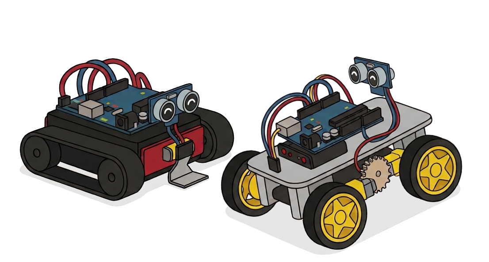

# Robos_Sommerville_ArenaComp

Firmware dos dois robôs da gincana universitária:

- **`sumo/`** — robô de sumô: encontra o oponente (VL53L0X via TCA9548A), empurra para fora e não cai da borda (HC-SR04 para baixo).
- **`rampa/`** — robô sobe-rampa: segue linha com sensor IR TCRT5000.

Documentação do projeto (orçamento, cronograma, riscos): [`plano-execucao.md`](plano-execucao.md).

## Estrutura

```
Robos_Sommerville_ArenaComp/
├── plano-execucao.md      # plano completo: orçamento, cronograma, riscos
├── docs/                  # esquemas do Tinkercad, tabela de pinos, montagem
├── cad/                   # STLs da carcaça escolhidos
├── sumo/                  # firmware do robô sumô (sketch do Arduino IDE)
│   ├── sumo.ino           # programa principal (setup + loop + lógica)
│   ├── config.h           # PINOS e constantes — ÚNICO lugar que muda ao religar fios
│   ├── motor.h / motor.c  # módulo: controle dos motores via ponte H
│   └── sensores.h / sensores.cpp  # módulo: VL53L0X (mux) + HC-SR04 (borda)
└── rampa/                 # firmware do robô sobe-rampa
    ├── rampa.ino
    ├── config.h
    └── motor.h / motor.c
```

## Como abrir (Arduino IDE 1.8+)

1. Instale a **Arduino IDE** e suporte a Arduino Uno (padrão).
2. Instale as bibliotecas em *Sketch → Include Library → Manage Libraries*:
   - `Adafruit VL53L0X` (só para o sumô)
   - `Adafruit TCA9548A` (só para o sumô)
3. Abra o sketch: *File → Open → `sumo/sumo.ino`* (a IDE carrega as pastas `sumo/` inteira — os módulos `.c/.h` na mesma pasta são compilados junto).
4. Selecione a placa **Arduino Uno** e a porta, e clique em Upload.

> O módulo `motor.c/.h` existe duplicado em `sumo/` e `rampa/` **de propósito**: cada sketch é autossuficiente, então mexer no de um não quebra o outro. Se corrigir um bug no motor, corrija nas duas cópias (ou avise o responsável do outro robô).

## Regra de ouro do projeto

**Nenhum número de pino no meio do código.** Todos os pinos e constantes de calibração ficam em `config.h`, no topo, comentados. Mudou a ligação na protoboard → muda só o `config.h`.

## Onde está cada coisa

| Preciso de... | Vá em... |
| --- | --- |
| Orçamento, lista de compras, cronograma | `plano-execucao.md` |
| Que pino liga em quê | `docs/tabela-pinos.md` e `config.h` de cada robô |
| Esquema elétrico | `docs/esquema-sumo.md` / `docs/esquema-rampa.md` (prints do Tinkercad) |
| Passo a passo de montagem | `docs/montagem.md` |
| STL da carcaça | `cad/` |
